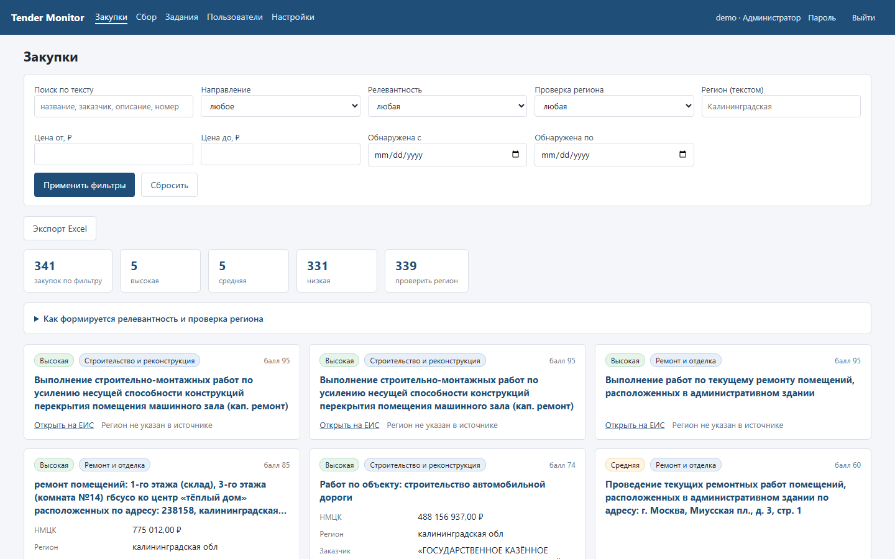
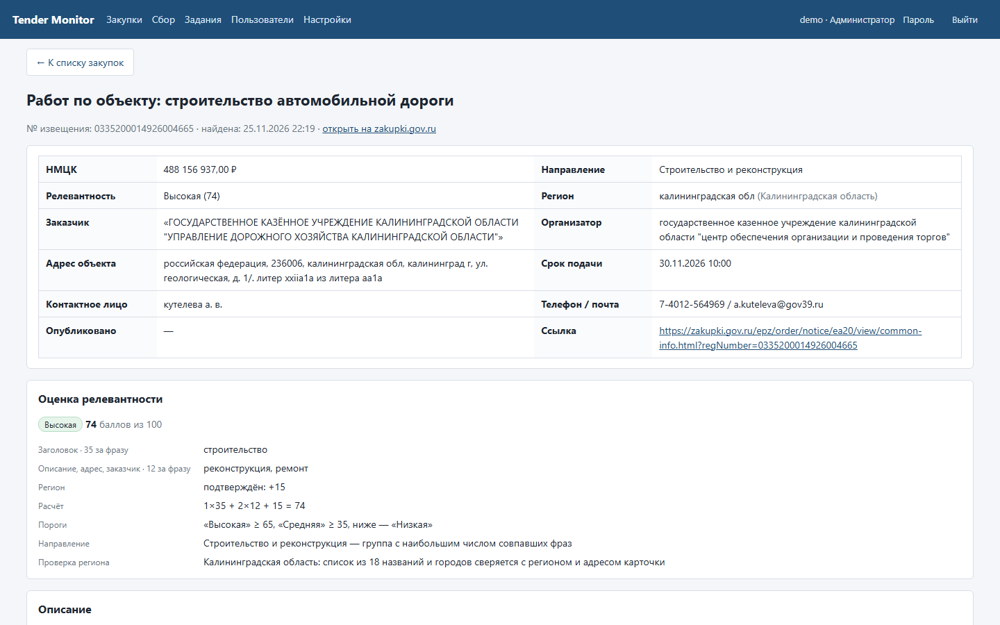
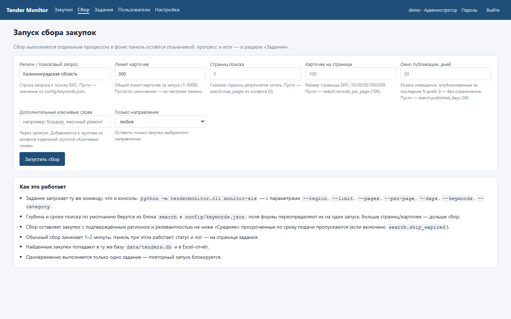
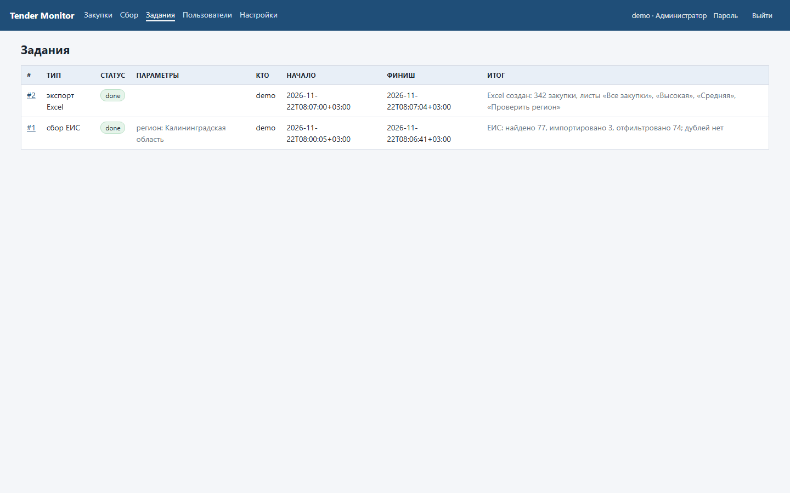
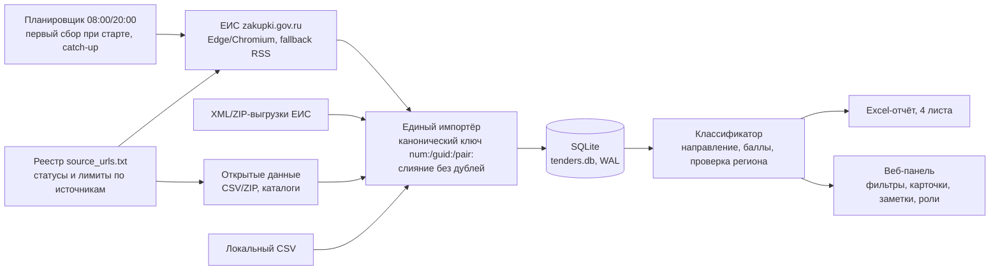

# Tender Monitor MVP

Локальный монитор открытых закупок ЕИС (zakupki.gov.ru) для Windows. Собирает карточки
закупок через браузер (Playwright: сначала Microsoft Edge, иначе Chromium), при неудаче
переключается на RSS-ленту ЕИС; умеет импортировать XML/ZIP-выгрузки ЕИС и CSV открытых
данных, классифицирует записи по ключевым словам и формирует отчёт Excel.

**Статус: MVP / демонстрационный парсер.** Разбор карточек выполняется по тексту страницы
и является best-effort: отдельные поля (заказчик, организатор, контакты, адрес) могут быть
пустыми или неточными. Перед принятием решений сверяйте данные с карточкой ЕИС по ссылке
из отчёта.

## Скриншоты

| Список закупок: фильтры, направления, баллы | Карточка: поля, контакты, разбор оценки |
|---|---|
|  |  |
| Запуск сбора с параметрами в фоне | Задания: статусы, итоги, логи |
|  |  |

Ещё: [вход](docs/screenshots/login.png), [пользователи и роли](docs/screenshots/users.png),
[настройки](docs/screenshots/settings.png). Скриншоты сняты с демо-данных
(фикстура открытых данных + живые карточки ЕИС), панель — локальная, без сборщиков и Node.js.

## Возможности

- `monitor-eis` — один сбор карточек расширенного поиска ЕИС и экспорт Excel;
- `schedule-eis` — сбор по расписанию (по умолчанию 08:00 и 20:00 по местному времени);
  первый сбор выполняется сразу при старте, пропущенные из-за сна/выключения слоты
  догоняются одним catch-up сбором;
- `import-eis` / `inspect-eis` — импорт и проверка XML/ZIP-выгрузок ЕИС;
- `import-eis-open-data` — импорт CSV/ZIP открытых данных по прямой ссылке или из локального файла;
- `import-csv` / `export` / `init` — локальный CSV, экспорт отчёта, создание базы;
- веб-панель (`web`) — локальная админ-панель: закупки с фильтрами, карточка закупки
  и заметки, запуск сбора с параметрами в фоне, учётные записи с ролями, настройки;
- сквозная дедупликация — одна закупка из ЕИС, XML/ZIP, CSV и открытых данных
  сливается в одну запись по каноническому ключу (номер извещения / GUID /
  пара source_id+URL), заметки и заполненные поля сохраняются;
- `collect-sources` — сбор по реестру официальных источников
  `config\source_urls.txt`: статус, счётчики и лимиты по каждому источнику,
  ошибка одного не валит остальные;
- отчёт `reports\tenders_report.xlsx` с листами «Все закупки», «Высокая», «Средняя», «Проверить регион»;
- 505 автономных проверок в `tests\` (`run_tests.bat`) — парсинг, классификатор,
  дедупликация, веб-панель, планировщик, батники; работают после клонирования.

## Как это работает



## Быстрый старт

Из папки `TenderMonitor_MVP`, двойным щелчком:

1. `install.bat` — окружение, зависимости, браузер, база (один раз);
2. `web_panel.bat` — панель на `http://127.0.0.1:8000/` (при первом запуске
   создаётся `admin`/`admin`, пароль меняется при первом входе);
3. `run_monitor.bat` — живой сбор ЕИС, либо `collect_sources.bat` — сбор по всем
   источникам реестра; либо `demo.bat` — проверка без сети;
4. `run_tests.bat` — все 505 проверок.

Подробности установки, флаги CLI и настройка — ниже.

## Проверки

`tests\` — семь автономных наборов (505 проверок): строительный профиль
классификатора, сборка и парсинг ЕИС, качество данных и DOM-пары, планировщик
и батники, веб-панель, пагинация и вёрстка, сквозная дедупликация и реестр
источников. Запуск — `run_tests.bat` или по одному файлу; пути относительные,
БД временные, сеть не нужна (браузерные сценарии — на стабах и локальных
fixture). Описание и изоляция: [`tests/README.md`](TenderMonitor_MVP/tests/README.md).

## Требования

- Windows 10/11;
- Python 3.11 или новее (проверено на 3.14). При установке Python отметьте
  «Add Python to PATH»; для `install.bat` нужен лаунчер `py`;
- интернет: для первой установки (скачивание Chromium, ~150 МБ) и для каждого сбора;
- Microsoft Edge желателен (используется первым); при его отсутствии ставится Chromium;
- Excel или совместимый просмотрщик — только чтобы открывать отчёт, для работы не нужен.

## Установка: порядок действий

В репозитории **нет и не должно быть** папки `.venv`, базы `data\tenders.db` и готовых
отчётов: это локальные артефакты, они создаются на вашей машине (см. `.gitignore`).
Поэтому после клонирования окружение нужно создать самостоятельно.

1. Клонируйте или скачайте репозиторий и перейдите в папку `TenderMonitor_MVP`.
2. Запустите `install.bat` (двойной щелчок). Он по порядку: удалит старое `.venv`,
   если оно есть; создаст новое через `py -3 -m venv .venv`; обновит pip; установит
   зависимости из `requirements.txt`; скачает браузер Chromium для Playwright;
   создаст базу данных (`init`). Дождитесь сообщения «Установка завершена».
3. Если предпочитаете вручную — те же шаги командами **из папки `TenderMonitor_MVP`**:

   ```
   py -3 -m venv .venv
   .venv\Scripts\python.exe -m pip install --upgrade pip
   .venv\Scripts\python.exe -m pip install -r requirements.txt
   .venv\Scripts\python.exe -m playwright install chromium
   .venv\Scripts\python.exe -m tendermonitor.cli init
   ```

4. Проверка без сети: запустите `demo.bat` (импорт `data\sample_tenders.csv` и экспорт)
   и откройте `reports\tenders_report.xlsx`. Ожидаемый вывод импорта при первом
   запуске: `Добавлено: 1; обновлено: 0; пропущено: 0`; при повторном запуске та же
   запись обновляется: `Добавлено: 0; обновлено: 1; пропущено: 0`.
5. Проверка парсера открытых данных:

   ```
   .venv\Scripts\python.exe -m tendermonitor.cli import-eis-open-data data\eis_open_data.csv
   ```

   Ожидаемый вывод: `Строк открытых данных: 342; добавлено/обновлено: 342; пропущено: 0`.
6. Живой сбор: `run_monitor.bat`. Сбор идёт в фоне (окно браузера при `"headless": true`
   не открывается) и занимает 1–2 минуты. В консоли сразу появляется строка о старте,
   затем прогресс `EIS cards: 5/36`, в конце — число проверенных карточек и путь к Excel.
   Окно закрывать нельзя: это прерывает сбор.
7. По желанию — расписание: `run_schedule.bat`. Окно нужно оставить открытым;
   остановка — `Ctrl+C`. Первый сбор выполняется сразу при старте; если компьютер
   спал или был выключен в плановое время (08:00/20:00), при следующем старте
   пропущенное догоняется одним сбором. Расписание и это поведение настраиваются
   в `config\keywords.json` (блок `schedule`), флаги `--no-run-at-start` и
   `--no-catch-up` отключают их разово.

Все команды вида `.venv\Scripts\python.exe -m tendermonitor.cli ...` выполняются из папки
`TenderMonitor_MVP`. Файлы `.bat` сами переходят в свою папку, их можно запускать откуда угодно.

## Команды CLI

| Команда | Назначение |
|---|---|
| `init` | создать/обновить структуру базы |
| `import-csv FILE` | импорт локального CSV; обязательны только колонки `source_id` и `title`, остальные необязательны (см. `data\sample_tenders.csv`) |
| `export` | пересобрать `reports\tenders_report.xlsx` |
| `inspect-eis FILE` | проверить XML/ZIP ЕИС без импорта |
| `import-eis FILE` | импортировать XML/ZIP ЕИС |
| `import-eis-open-data SOURCE` | импорт CSV/ZIP открытых данных (URL или путь к файлу) |
| `monitor-eis` | один сбор ЕИС + экспорт |
| `collect-sources` | сбор по всем источникам из `config\source_urls.txt` (ЕИС, порталы, открытые данные) + экспорт |
| `schedule-eis` | сбор по расписанию (по умолчанию 08:00 и 20:00, первый сбор при старте, catch-up пропущенных слотов) |
| `web` | локальная веб-панель администрирования (`--host`, `--port`, `--debug`) |
| `user-add LOGIN ROLE` | создать пользователя панели из консоли (`admin`/`operator`/`viewer`, `--password`) |

Флаги `schedule-eis`: `--no-run-at-start` — не делать первый сбор сразу;
`--no-catch-up` — не догонять пропущенные слоты. Постоянные значения задаются
в конфиге (блок `schedule`).

Флаги `monitor-eis` (для веб-панели и разовых сборов): `--region` — регион
поиска, `--limit` — общий лимит карточек за запуск, `--pages` — число страниц
поиска, `--per-page` — карточек на странице ЕИС (10/20/50/100/200), `--days` —
окно публикации извещения в днях (0 — без ограничения), `--keywords` —
дополнительные ключевые слова через запятую, `--category` — оставить только одно
направление. Без этих флагов глубина и сроки берутся из блока `search` конфига
(по умолчанию 5 страниц по 100 карточек, окно публикации 30 дней, общий лимит
1000 карточек). Сбор оставляет только закупки с подтверждённым регионом,
определённым направлением и релевантностью не ниже порога «Средняя»; просроченные
по сроку подачи пропускаются (`search.skip_expired`).

Импорт считает новые записи и обновления раздельно: `import-csv` выводит
«Добавлено: N; обновлено: M; пропущено: K» (повторный импорт того же файла
обновляет существующие записи, а не дублирует их).

Сквозная дедупликация (`tendermonitor\dedup.py`): каждая запись получает
канонический ключ `canonical_key`. Приоритет — нормализованный номер извещения
(`num:<цифры>`), извлечённый из URL (`regNumber=`, `purchaseNumber=`,
`noticeNumber=`, `purchaseId=`, `noticeId=`, числовой `searchString=`) или из
`source_id` (в т.ч. с «№» и пробелами). Длина номера не фиксирована: принимаются
цифровые строки 8–25 знаков (19-значные номера ЕИС, 20-значные нового формата,
более короткие региональные); 36-значный ИКЗ номером не считается. Если номера
нет, используется guid извещения (`guid:<uuid>`), иначе — безопасный fallback
`pair:<source_id>|<нормализованный url>` (URLlowercase-хост без `www.`, фрагмента
и трекинговых параметров). Одна и та же закупка из разных источников (ЕИС
RSS/браузер, открытые данные, CSV/XLSX/XML) с разными URL или форматами номера
сливается в одну запись: заполненные поля и заметка `note` сохраняются, пустые
дозаполняются, `first_seen` не меняется. Excel-отчёт и список веб-панели
схлопывают строки по `canonical_key`. Миграция (`init`) проставляет ключ старым
записям и сливает накопленные дубли.

Флаги `collect-sources`: `--region`, `--limit`, `--pages`, `--per-page`,
`--days` — применяются к источнику ЕИС (как у `monitor-eis`). Реестр
(`tendermonitor\sources\registry.py`) читает `config\source_urls.txt` (строки
«Метка: URL», комментарии `#` пропускаются) и классифицирует каждый URL:
ЕИС (`zakupki.gov.ru`) → сбор `eis_browser`; прямая ссылка на `.csv/.zip/.xlsx`
→ импорт открытых данных; каталог открытых данных (`data.gov.ru`,
`rlw.gov.ru/opendata`) → поиск прямых файлов и проверка ближайшего набора на
закупочные колонки (наборы-указатели и SPA-каталоги пропускаются с логом);
портал закупок без адаптера (`zakupki.gov39.ru`) → проверка доступности и
пропуск. По каждому источнику логируются статус, найдено/импортировано/
отфильтровано/пропущено и лимиты; ошибка одного источника не валит весь сбор.

## BAT-скрипты

Все `.bat` лежат в папке `TenderMonitor_MVP`, сами переходят в свою папку и
проверяют наличие `.venv\Scripts\python.exe`: если окружение не собрано,
выводят понятное сообщение и просят запустить `install.bat`.

| Скрипт | Что делает |
|---|---|
| `install.bat` | создаёт `.venv`, ставит зависимости и Chromium, инициализирует базу |
| `demo.bat` | импорт `data\sample_tenders.csv` + экспорт Excel (проверка без сети) |
| `run_monitor.bat` | один живой сбор ЕИС (`monitor-eis`) + экспорт |
| `collect_sources.bat` | сбор по всем источникам из `config\source_urls.txt` (`collect-sources`) + экспорт; флаги передаются как есть |
| `run_schedule.bat` | постоянная работа по расписанию (`schedule-eis`) |
| `import_csv.bat [FILE]` | импорт CSV: перетащите файл на скрипт или передайте путь аргументом; без аргумента берётся `data\incoming.csv` |
| `import_eis.bat FILE` | импорт XML/ZIP-выгрузки ЕИС: перетащите файл на скрипт или передайте путь аргументом |
| `export_excel.bat` | только пересборка отчёта Excel |
| `web_panel.bat` | запуск веб-панели на `http://127.0.0.1:8000/` |
| `run_tests.bat` | полный прогон проверок: 7 наборов, 505 проверок (`tests\README.md`) |

## Веб-панель

Локальная админ-панель на Flask + Jinja2 (обычные HTML/CSS/JS, без сборщика):
список найденных закупок с фильтрами, карточка закупки, запуск сбора из
панели, учётные записи с ролями, настройки.

Запуск:

```
web_panel.bat
```
или
```
.venv\Scripts\python.exe -m tendermonitor.cli web --host 127.0.0.1 --port 8000
```

Панель откроется на `http://127.0.0.1:8000/`. При первом запуске создаётся
администратор `admin` / `admin` — пароль обязательно меняется при первом входе
(до смены доступна только страница смены пароля). Дополнительных пользователей
создаёт администратор в разделе «Пользователи» или командой
`user-add ЛОГИН РОЛЬ`.

Роли и права:

| Роль | Права |
|---|---|
| Администратор | всё: закупки, запуск сбора, заметки, пользователи, настройки |
| Оператор | просмотр закупок, запуск сбора и экспорта, заметки |
| Наблюдатель | только просмотр закупок |

Что умеет панель:

- **Закупки** — карточки найденных закупок с фильтрами: поиск по тексту
  (учитывает словоформы: «песок» находит «поставка песка»), направление,
  релевантность, проверка региона, регион текстом, диапазон цены, период
  обнаружения; счётчики по релевантности и постраничная навигация.
  В карточке показываются только заполненные поля (цена, регион, заказчик,
  срок, ссылка на ЕИС); пустые значения скрыты. Блок «Как формируется
  релевантность» объясняет баллы, пороги и проверку региона.
- **Карточка закупки** — все поля, ссылка на ЕИС, описание, заметка оператора
  (заметки не затираются при повторном импорте) и разбор оценки: совпавшие
  фразы по зонам, вклад региона, стоп-фразы профиля, расчёт балла и активные
  пороги/веса.
- **Сбор** — форма запуска с параметрами (регион, общий лимит карточек, число
  страниц поиска, карточек на странице, окно публикации в днях, дополнительные
  ключевые слова, только одно направление). Пустые поля глубины/сроков берутся
  из блока `search` конфига. Задание выполняется отдельным процессом в фоне —
  та же команда `monitor-eis` с соответствующими флагами, поэтому панель не
  блокируется, а статус и журнал видны на странице задания. Одновременно
  выполняется только одно задание, его можно остановить.
- **Задания** — история запусков с параметрами, статусом и журналом вывода.
- **Настройки** (администратор) — регион, пороги релевантности, режимы
  (`headless`, `demo_include_all`), расписание, глубина и сроки поиска
  (`search`: размер страницы, число страниц, общий лимит, окно публикации,
  пропуск просроченных, CA-сертификат для RSS); правка `config\keywords.json`
  с резервной копией `config\keywords.json.bak`. Группы ключевых слов и
  стоп-фразы в панели пока не редактируются (показаны справочно).

Где хранится состояние панели:

- `data\app.db` — пользователи и роли, настройки панели, задания и их статусы.
  Отдельный файл от `tenders.db` намеренно: сборщик пишет в `tenders.db`,
  панель его читает, и разные файлы не блокируют друг друга (обе базы в режиме WAL).
- `data\app_secret.key` — ключ подписи cookie-сессии (создаётся автоматически,
  в репозиторий не коммитится).
- `config\keywords.json` — конфигурация сбора, общая для панели и консоли.

## Форматы входных данных

- **Локальный CSV (`import-csv`)**: кодировка UTF-8 (допускается BOM), разделитель —
  запятая. Обязательные колонки: `source_id`, `title`. Необязательные: `price`,
  `address`, `customer`, `deadline`, `contact_name`, `contact_phone`, `contact_email`,
  `url`, `region`, `description`, `published_at`, а также `organizer`, `deadline_time`,
  `object_address`. Отсутствующие колонки заполняются пустыми значениями. Полный
  образец — `data\sample_tenders.csv`. Цена может быть строкой вида «2 874 509,65 ₽».
- **Открытые данные ЕИС (`import-eis-open-data`)**: CSV или ZIP с CSV по прямой
  ссылке либо локальный файл. Кодировки UTF-8/Windows-1251, разделители `;`, `,`,
  таб — определяются автоматически. Русские и английские заголовки распознаются
  по словарю синонимов («номер извещения», «объект закупки», «нмцк», «заказчик» и
  т.п.); обязательны номер и название. Если ссылки нет, она строится из номера
  закупки. Пример выгрузки — `data\eis_open_data.csv` (342 строки).
- **XML/ZIP ЕИС (`import-eis` / `inspect-eis`)**: официальные выгрузки, скачанные
  через авторизованный канал. Поля извлекаются по именам тегов (best-effort,
  схемы зависят от закона и типа документа). ИКЗ намеренно не используется как
  номер закупки: это отдельный код позиции плана-графика, он не должен подменять
  номер извещения. Перед импортом удобно проверить файл через `inspect-eis`.

## Где что лежит

- `config\keywords.json` — регион поиска (`region`), список регионов и городов (`regions`),
  ключевые слова по направлениям (`groups`), пороги релевантности (`thresholds`),
  демо-режим (`demo_include_all`), фоновый браузер (`headless`) и расписание (`schedule`);
- `config\source_urls.txt` — ссылки на источники;
- `data\` — база `tenders.db` (создаётся при работе), образцы CSV и
  `schedule_state.json` (время последнего успешного сбора планировщика);
  отдельно `data\app.db` — пользователи, настройки и задания веб-панели
  и `data\app_secret.key` — ключ подписи сессии панели;
- `reports\tenders_report.xlsx` — отчёт, перезаписывается при каждом экспорте;
- `logs\app.log` — полный журнал; `last_run.log` — журнал последнего запуска;
- `tendermonitor\` — код; `tendermonitor\sources\` — адаптеры источников;
- `.bat` — ярлыки запуска для Windows.

Образцы CSV: `sample_tenders.csv` нужен для `demo.bat`; `eis_open_data.csv` — пример
выгрузки открытых данных для проверки парсера. Файлы `data\incoming*.csv` — ваши локальные
импорты, в репозиторий не коммитятся.

## Параметры конфигурации

Все параметры — в `config\keywords.json`, читаются при каждом запуске:

| Ключ | По умолчанию | Назначение |
|---|---|---|
| `region` | `"Калининградская область"` | регион для поиска на ЕИС и запасное значение региона карточки; пустая строка — поиск без регионального ограничения |
| `regions` | список городов Калининградской области | названия/города в нижнем регистре для проверки региона классификатором |
| `groups` | 8 строительных направлений | ключевые фразы по направлениям («Строительство и реконструкция», «Ремонт и отделка», «Дороги и благоустройство», «Инженерные сети и монтаж», «Стройматериалы», «Проектирование и изыскания», «Спецтехника и земляные работы», «Зимнее содержание дорог») |
| `stop_phrases` | список шумовых фраз | стоп-фразы профиля (мебель, ИТ-оборудование, ГСМ, питание, клининг и т.п.): совпадение в заголовке снижает балл на `scoring.stop_penalty` |
| `negations` | `["не","без","кроме",…]` | отрицания рядом с фразой отменяют совпадение (дополняют встроенный список) |
| `scoring` | `{"title_weight":35,"other_weight":12,"region_bonus":15,"region_penalty":10,"stop_penalty":60}` | веса зон и штрафов классификатора |
| `thresholds` | `{"high": 65, "medium": 35}` | пороги релевантности «Высокая»/«Средняя»; сбор оставляет записи не ниже `medium` |
| `search.records_per_page` | `100` | карточек на странице ЕИС (10/20/50/100/200; сервер отдаёт не более 200) |
| `search.max_pages` | `5` | сколько страниц поиска читать за запуск |
| `search.max_cards` | `1000` | общий лимит карточек за запуск (0 — без ограничения) |
| `search.published_days` | `30` | окно публикации извещения в днях (0 — без ограничения по дате) |
| `search.skip_expired` | `true` | пропускать закупки с истёкшим сроком подачи |
| `search.ca_bundle` | `config/certs/russian_trusted_ca.pem` | путь к CA-сертификату для RSS, реестра источников и импорта открытых данных (абсолютный или относительный от корня проекта). По умолчанию приложен официальный корень и промежуточные сертификаты НУЦ Минцифры — без них OpenSSL не доверяет цепочке zakupki.gov.ru. Проверка сертификата не отключается |
| `demo_include_all` | `false` | `true` отключает фильтры по ключевым словам и региону (все карточки в базу) |
| `headless` | `true` | фоновый браузер; `false` — видимое окно для отладки |
| `schedule.times` | `["08:00", "20:00"]` | плановые слоты в местном времени, формат «ЧЧ:ММ» |
| `schedule.run_at_start` | `true` | первый сбор сразу при старте планировщика |
| `schedule.catch_up` | `true` | один догоняющий сбор при старте, если плановые слоты пропущены (сон/выключение) |

Старые конфиги без новых ключей продолжают работать: значения берутся по умолчанию.

## Настройка под свой регион (не Калининградская область)

Регион больше не зашит в код: он задаётся в `config\keywords.json`.

1. `"region"` — название региона для поиска на ЕИС (строка поиска и RSS-запрос) и
   запасное значение региона карточки, если на странице нет поля «Субъект Российской
   Федерации». Пустая строка означает поиск без регионального ограничения.
2. `"regions"` — список названий и городов вашего региона в нижнем регистре. По нему
   классификатор проверяет регион карточки (поле региона + адрес) и начисляет баллы;
   метка успешной проверки в отчёте берётся из `"region"`.

После замены прогоните `monitor-eis` и посмотрите лист «Проверить регион» в отчёте:
туда попадают карточки, чей регион и адрес не совпали со списком `"regions"`.
Браузерный сбор читает регион из самой карточки (поле «Субъект Российской Федерации»),
поэтому фильтр по региону работает по данным страницы, а не по константе. Если поле
на странице отсутствует, используется `"region"` из конфига (для RSS — всегда он).

## Ключевые слова и пороги

Направления и пороги задаются в `config\keywords.json` (`groups`, `thresholds`).
Классификатор сопоставляет фразы **по основам слов** (лёгкий стемминг без внешних
зависимостей): «ремонт дороги» находит «ремонта дороги», «поставка песка» — «поставку
песка», «асфальтобетон» — «асфальтобетонная смесь». Совпадения рядом с отрицаниями
(«не требуется», «без», «за исключением») баллов не дают. Направление определяется
группой с наибольшим числом совпавших фраз.

Баллы (веса настраиваются в блоке `scoring`): `title_weight` = 35 за совпадение в
заголовке, `other_weight` = 12 за совпадение в описании/адресе/заказчике,
`region_bonus` = +15 при подтверждённом регионе и `region_penalty` = −10 без него.
Стоп-фразы профиля (`stop_phrases`) при совпадении в заголовке снижают балл на
`stop_penalty` = 60 — так отсекается нерелевантный шум («ремонт компьютеров»,
«монтаж серверного оборудования», «поставка мебели», ГСМ, питание, клининг).
Отрицания (`negations`) рядом с фразой отменяют совпадение. Пороги по умолчанию:
`high` = 65, `medium` = 35. Направление — группа с наибольшим числом совпавших
фраз; при равенстве побеждает более специфичная (длинная) фраза: «ремонт дороги»
важнее общего «ремонт». Одна фраза, встречающаяся в нескольких группах, считается
один раз. Пороги и веса подобраны демонстрационно и требуют калибровки под вашу
практику.

## Известные ограничения MVP

- Демо-режим выключен по умолчанию: `"demo_include_all": false` в `config\keywords.json`.
  Если поставить `true`, фильтры по ключевым словам и региону отключаются и в базу
  попадают все найденные карточки, включая нерелевантные.
- Браузер по умолчанию работает в фоне: `"headless": true` в `config\keywords.json`.
  Для отладки с видимым окном поставьте `false`.
- RSS-запрос проверяет TLS-сертификат и не отключает проверку. Цепочка
  zakupki.gov.ru ведёт к корню НУЦ Минцифры («Russian Trusted Root CA»), которого
  нет в дефолтном бандле OpenSSL, поэтому в проект положен официальный bundle
  `config/certs/russian_trusted_ca.pem` (корень + промежуточные, скачаны с
  `gu-st.ru/content/downloads/`), и `search.ca_bundle` по умолчанию указывает на
  него. В сети с TLS-инспектирующим прокси добавьте корпоративный CA в этот файл
  или укажите свой путь в `search.ca_bundle` (относительные пути считаются от
  корня проекта). Браузерный сбор при этом работает независимо от TLS-настроек
  Python (Edge запускается с `--ignore-certificate-errors`).
- Глубина поиска влияет на время сбора: браузерный сбор читает каждую карточку
  отдельной вкладкой, поэтому сотни карточек занимают минуты. RSS-лента
  многостранична и быстра, но не содержит адреса/организатора/срока подачи;
  наименование объекта закупки извлекается из description (служебный `<title>`
  ленты — «Электронный аукцион №…»). Увеличивайте
  `search.max_pages`/`max_cards` осознанно.
- Парсинг карточек best-effort: значения полей берутся из DOM-пар «метка → значение»
  с резервом по строкам текста; отдельные поля всё равно могут быть пустыми или
  неточными — сверяйте с ЕИС.
- На части карточек (например, запрос котировок в электронной форме, где размещение
  ведёт уполномоченный орган/фонд) поля «Наименование заказчика» на странице нет —
  заказчик остаётся пустым, организатор при этом определяется корректно. Название
  учреждения из текста объекта закупки намеренно не подставляется: оно может
  относиться к объекту, а не к заказчику.
- Планировщик работает, пока открыто его окно (это не служба Windows). Первый сбор
  идёт сразу при старте; пропущенные из-за сна/выключения слоты догоняются одним
  сбором при следующем старте, а не отдельным запуском на каждый пропущенный слот.
  Сон во время работы обрабатывается: после пробуждения плановый сбор идёт сразу.
  Время последнего успешного сбора — `data\schedule_state.json`; удалите файл,
  чтобы сбросить историю catch-up.
- Отчёт перезаписывается целиком; история версий хранится в базе, в отчёт попадает
  последняя актуальная версия каждой закупки.
- Веб-панель рассчитана на локальный запуск: встроенный сервер Flask без HTTPS,
  слушает `127.0.0.1` и не рассчитан на доступ из сети или публикацию наружу.
  Сессия живёт 12 часов, пароли хранятся в виде хешей (pbkdf2), но забытый пароль
  восстанавливается только администратором (сброс пароля) — «забытый пароль» на
  почту не отправляется.
- В панели одновременно выполняется только одно фоновое задание (сбор или экспорт):
  следующий запуск блокируется, пока текущий не завершён. Задания, прерванные
  перезапуском сервера, помечаются как «прервано».
- Экспорт Excel из панели падает, если отчёт открыт в Excel (файл заблокирован) —
  закройте `reports\tenders_report.xlsx` и повторите.
- Поиск по тексту в панели ищет по упрощённым основам слов, поэтому возможны
  «лишние» совпадения (например, «песок» найдёт и «песчаный»).
- Дата «обнаружена» в панели — местное время; в базе она хранится в UTC.

## Диагностика типовых проблем

- `did not find executable ... pythoncore-3.15...` или пустое `.venv` — окружение ссылается
  на удалённый Python. Удалите папку `.venv` и запустите `install.bat` заново.
- Обрывки слов вида `'ist' is not recognized ...` при запуске `.bat` — файл сохранён
  с переносами LF. Скрипты `.bat` должны быть в CRLF; в репозитории это гарантирует
  `.gitattributes`, не пересохраняйте их редактором с LF.
- `PermissionError ... reports\tenders_report.xlsx` — отчёт открыт в Excel. Закройте его
  и повторите `export`.
- `Системе не удается найти указанный путь` — команда запускается не из папки
  `TenderMonitor_MVP` либо к ней приписан лишний `cd`. Сначала `cd /d <путь>\TenderMonitor_MVP`,
  затем отдельной строкой сама команда.
- `ModuleNotFoundError: No module named 'playwright'` — установка не завершена;
  выполните шаги установки выше.
- В `last_run.log` строка `method=RSS` — браузерный сбор не удался, использована RSS-лента.
  Это штатный fallback, не ошибка.
- Сбор идёт, но карточек мало или поля пустые — поставьте `"headless": false` в
  `config\keywords.json` и повторите `monitor-eis`: увидите окно браузера и сможете
  проверить, что страница ЕИС отдаёт результаты (капча, редизайн, блокировка).
- `database is locked` — параллельно запущены ещё один сбор или экспорт; дождитесь завершения.

## Данные и приватность

База, отчёты и журналы хранятся только локально и не коммитятся (`.gitignore`). Сбор идёт
с публичных страниц ЕИС; соблюдайте правила сайта и разумную частоту запросов.
